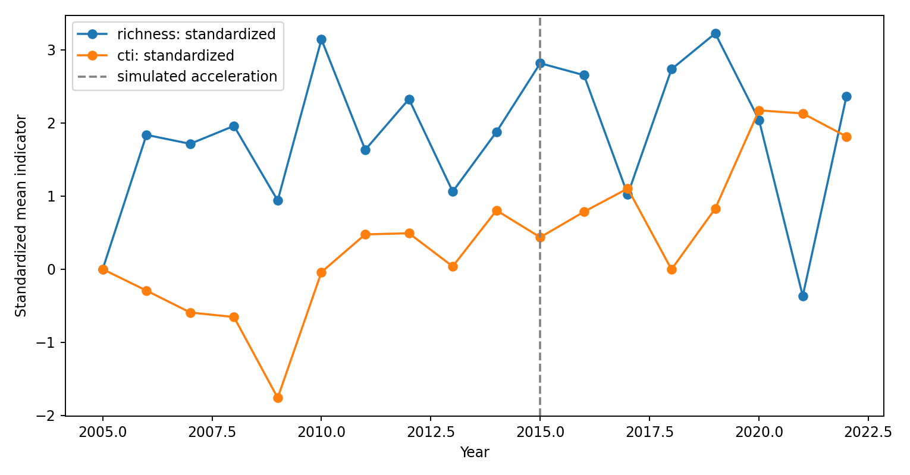
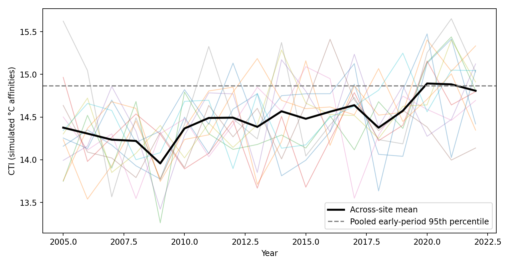
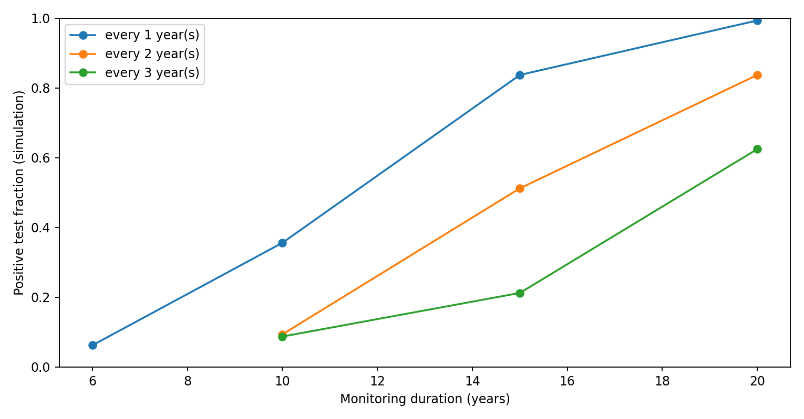

# EcoSignal

**Statistical assessment of DNA-derived biodiversity indicators and ecological monitoring design**

EcoSignal is an open-source Python framework for quantifying changes in DNA-derived community indicators, investigating their statistical detectability, and examining how the duration and frequency of ecological monitoring affect inference. The analysis begins with curated site-by-time taxon detections and associated metadata, rather than raw sequence reads.

The central question is **whether an apparent change in a molecular biodiversity indicator represents an interpretable ecological signal, and how sensitive that inference is to the observation and monitoring design.**


## Research questions

1. **Complementarity of indicators.** Can taxon richness remain approximately stable while molecular community composition changes?
2. **Longitudinal trends.** What temporal signal is detectable after accounting for stable differences among monitoring sites?
3. **Reference conditions.** How does an early observation period define a descriptive baseline, and how does the choice of threshold affect alert classification?
4. **Change-point screening.** Can piecewise trend models improve fit over a single linear trajectory?
5. **Monitoring design.** How do sampling interval and study duration affect the probability of detecting a specified ecological trend?

## Reproducibility

Requirements: Python 3.10 or newer on Windows, Linux or macOS. The demonstration generates all inputs from a fixed random seed; it does not access external services.

```bash
python -m pip install -r requirements.txt
python run_demo.py
python -m pytest -q
```

Run from the repository's top-level directory. Outputs are written to `results/` and replace the committed example results. For clean isolation, create a Python virtual environment first (optional). The scripts require no GPU or HPC scheduler.

## Study design and data provenance

The supplied analysis uses a **synthetic ecological monitoring scenario**, not measured metabarcoding reads or published observations: 12 monitoring sites, 18 annual surveys (2005–2022), and 65 hypothetical taxa. Taxa are assigned different simulated thermal affinities. A directional environmental process affects true occupancy probability, with faster community change after 2015; imperfect observation converts the latent community to recorded taxon detections. This creates distinct ecological and observation processes while preserving known simulation parameters.

- `results/metadata.csv`: site, year, simulated temperature, precipitation and event indicators.
- `results/detections.csv`: binary taxon detections; these are **not** abundance or read counts.
- `results/taxon_traits.csv`: hypothetical taxon thermal affinities used by the indicator.

All simulation inputs are generated by `ecosignal/simulation.py`. The temperature, precipitation and event columns provide contextual metadata, but only year and site are currently used by the fitted trend screens. No observed climate relationship or causal attribution is claimed.

## Indicator definitions

**Observed richness** is the count of detected taxa at a site and observation year. It reflects taxon detection and therefore depends on sampling and laboratory consistency.

**Adjacent-year Jaccard dissimilarity** is the fraction of taxa detected in either of two consecutive site surveys that are not shared. It describes compositional dissimilarity, including richness differences; it is not a pure replacement component.

**Community temperature index** is the unweighted mean of simulated thermal affinities of detected taxa in each site-year, without abundance or sequencing-read weights. Formally, for detection indicator \(z_{ist}\in\{0,1\}\) and taxon thermal affinity \(T_i\):

\[
\mathrm{CTI}_{st}=\frac{\sum_i z_{ist}T_i}{\sum_i z_{ist}}.
\]

This statistic measures the composition of the detected assemblage on the artificial affinity scale. It is **not** a calibrated climatic impact metric. Empty detected assemblages have undefined CTI rather than being assigned zero.

## Statistical analysis

**Site-adjusted linear trend.** Ordinary least squares with site fixed intercepts estimates a shared slope. Uncertainty is summarized by resampling whole sites. This accounts for site-level clustering in a descriptive fashion, but it does not fit temporal autocorrelation, seasonality, nonlinear ecological responses, or an explicit detection likelihood.

**Exploratory breakpoint comparison.** A continuous piecewise linear model is compared with the common-slope model using the Bayesian information criterion (BIC). The selected breakpoint is descriptive; scanning candidate years invalidates interpreting the fit difference as a conventional significance test. Simulation-based calibration is needed for statistical change-point claims.

**Reference-period screen.** An upper empirical quantile of early-period CTI observations produces an illustrative pooled threshold and site-year exceedance labels. This is *not* a validated ecological reference condition or policy alert rule: sites can differ in their baseline states, and threshold uncertainty is not yet calibrated.

**Monitoring-duration screen.** Repeated Gaussian simulations with a known linear trend compare ordinary-regression positive-test rates across combinations of study length and observation interval. The zero-trend scenario estimates the test's false-positive frequency. These simulations assume independent errors, so their results are **method benchmarks, not field-sampling recommendations**.

## Results

The repository commits the deterministic example results and figures. They can be regenerated with the command above.

### Indicator trajectories



In the constructed scenario, richness and thermal composition need not change in the same direction or at the same rate. The dashed line denotes the time at which the simulation increases the rate of environmental change, **not an estimated break in observed field data**. Each curve is standardized independently and should not be read as an effect-size comparison on a common ecological scale.

### Site variation and reference-condition screen



Individual sites vary around the cross-site mean; the dashed horizontal line denotes a pooled early-period quantile. Exceedances show properties of this screen under the stated simulation, not environmental-quality classifications.

### Monitoring duration and sampling interval



The curves give the fraction of simulated linear-model tests returning p < 0.05 under a fixed nonzero slope and independent errors. They illustrate the information loss from sparser sampling, but cannot determine the optimal design for real eDNA surveys without calibrated noise, seasonality, spatial replication and detection models.

The machine-readable numerical results are in `results/summary.json`, `results/indicators.csv`, and `results/power_screen.csv`. The saved input tables make it possible to independently inspect the simulated observations.

## Scope and inference boundaries

This repository evaluates indicators **after** taxonomic assignment. It does not perform ASV inference, read processing, contamination filtering, reference-database curation or metagenomic functional profiling. No single diversity statistic is assumed to describe ecological condition completely.

Several key sources of variation require separate modelling for empirical use: imperfect detection, technical replicates, sample preservation, taxonomic assignment uncertainty, site-specific responses, repeated-measurement correlation, climatic lag effects and reference-state heterogeneity. The present model screens are explicitly narrower than such a complete joint model.

For a real dataset, the taxon identifiers and sampling universe must be consistent across years. Missing samples must not be encoded as true absences, and read counts must not automatically be treated as organism abundances.

## Extending the analysis to empirical monitoring

The computational core is separated into `ecosignal/indicators.py` (indicator calculations), `ecosignal/models.py` (trend and design screens) and `ecosignal/simulation.py` (known-truth data generator). To analyse empirical observations, provide curated `site`, `year`, `taxon`, and binary `detected` records, corresponding site-year environmental metadata, and independently justified taxon traits where a thermal index is desired. The `build_indicators` function accepts pandas DataFrames and checks for duplicate detections and incomplete site-year-by-taxon tables. A general file-import command-line interface is not yet part of the package.

The following are distinct statistical extensions, rather than results demonstrated by the current code: hierarchical detection and occupancy models; site-specific nonlinear time-series models; autocorrelation-aware trend estimation; calibrated change-point uncertainty; environmental-driver attribution; empirically supported thermal-affinity databases; independent indicator validation; and power analyses that reflect seasonal, spatial and technical variability.

## Source code and outputs

| Location | Content |
|---|---|
| `run_demo.py` | Runs the complete reproducible example and generates all output files |
| `ecosignal/simulation.py` | Ecological and imperfect-detection simulation |
| `ecosignal/indicators.py` | Richness, dissimilarity, CTI and reference screen |
| `ecosignal/models.py` | Trend, breakpoint and monitoring design screens |
| `tests/test_methods.py` | Reproducibility, input-validation and mathematical checks |
| `results/` | Simulated input tables, indicators, summaries and figures |
| `assets/workflow.svg` | Vector illustration of the analytical workflow |

## Scientific context

Molecular biodiversity monitoring requires a distinction between *detection*, *community composition*, and *inference about ecological change*. The empirical motivation for this framework includes work on eDNA sampling uncertainty and ecological biodiversity responses:

- Shuvo, M. J., Tabassum, T., & Segelbacher, G. (2025). Optimizing eDNA metabarcoding techniques for assessing arthropod communities in tree-related microhabitats. *Environmental DNA*, 7, e70064. https://doi.org/10.1002/edn3.70064
- Shuvo, M. J., Wohlwend, M., Heer, K., Paillet, Y., & Segelbacher, G. (2026). Influence of deadwood, tree-related microhabitats, and forest structural features on saproxylic arthropod diversity. *Ecology and Evolution*, 16, e73600. https://doi.org/10.1002/ece3.73600
- Shuvo, M. J., Segelbacher, G., & Geue, J. C. (2026). PoLoCo: A reproducible pooled low-coverage workflow for draft genome assembly and allele frequency analysis from ethanol-preserved small non-model invertebrates. *GigaByte*. https://doi.org/10.46471/gigabyte.195

These publications motivate the statistical questions; their underlying empirical datasets are **not included** in the EcoSignal demonstration.

## Citation and license

Mohammad Jamil Shuvo. *EcoSignal: Statistical assessment of DNA-derived biodiversity indicators and ecological monitoring design*. Source code: https://github.com/MohammadJamilShuvo/EcoSignal. MIT License. The repository's `CITATION.cff` provides machine-readable citation metadata.
